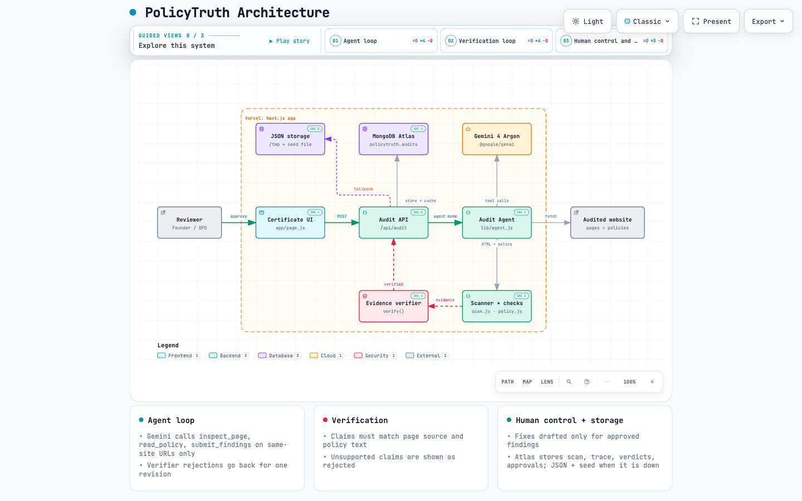

# PolicyTruth architecture

PolicyTruth is a single Next.js app on Vercel. A reviewer starts a test from the certificate UI. The audit API runs either a quick audit or a Gemini tool-calling agent. Every model claim passes through a deterministic evidence verifier. Results, agent traces, approvals and fixes are stored in MongoDB Atlas, or in JSON storage when Atlas is unreachable.

Interactive diagram with guided views, search and export: open [`docs/architecture.html`](docs/architecture.html) in a browser. Its source spec is [`docs/architecture.json`](docs/architecture.json) (Archify, validated at the showcase quality profile).

## Components

| Component | Code | Responsibility |
|---|---|---|
| Certificate UI | `app/page.js`, `components/` | Runs tests and shows the result as a certificate (verdict, score, defect tally, readings) with Defects, Inspection, Test log and Fixes views, a history drawer and exports. Caches today's results in `localStorage`. |
| Audit API | `app/api/audit/route.js` | `POST` runs a quick or agent audit, or drafts fixes for approved findings. `GET` lists recent audits. Serves same-day results from storage before calling Gemini. |
| Audit Agent | `lib/agent.js` | Gemini function-calling loop with `inspect_page`, `read_policy` and `submit_findings`. Budget: 6 pages, 10 steps. |
| Scanner and checks | `lib/scan.js`, `lib/policy.js` | Deterministic evidence: 15 tracker vendors, 8 consent managers, consent gating, vendor disclosure, Article 13 coverage, readability, policy age, privacy headers. |
| Evidence verifier | `verify()` in `lib/scan.js` | Rejects model claims that the page source or the policy text does not support. |
| Gemini | `@google/genai`, `gemini-4-argon` | Plans the agent's tool calls, reasons over full policy text, drafts fixes. |
| MongoDB Atlas | `lib/db.js`, collection `policytruth.audits` | One document per audit: scan, findings, verdicts, agent trace, approvals, fixes. Powers history, the same-day cache and tracker drift. |
| JSON storage | `lib/db.js`, `data/audits.seed.json` | Fallback when `MONGODB_URI` is unset or Atlas is unreachable: the same documents in a JSON file (`/tmp` on Vercel) with an in-memory cache, plus a bundled read-only seed of recent audits. |

## Audit flow (agent mode)

1. The reviewer submits a URL. The API returns today's stored audit if one exists, unless `force` is set.
2. The agent asks Gemini for its next step. Gemini calls `inspect_page` on the homepage, then on the pages likely to carry extra trackers, then `read_policy` on each privacy and cookie policy it finds. Calls can run in parallel.
3. Each tool fetches the page and runs the deterministic scanner. The tool returns trackers, consent managers and same-site links, or the policy text with Article 13 coverage.
4. Gemini calls `submit_findings`. The verifier checks every finding against the combined page source and policy text.
5. If the verifier rejects findings, the rejection reasons go back to Gemini. It can gather more evidence or drop claims, then resubmit. This happens at most once.
6. The API scores the verified findings, compares trackers with the previous audit of the same host, and stores the result in Atlas (or JSON storage).
7. The reviewer approves findings in the dashboard. Only then does Gemini draft consent-gated code and a privacy policy addition. The approval and fixes are saved on the same audit document.

Quick mode skips steps 2 to 5: it fetches the homepage and its linked policy, runs the scanner, makes one Gemini analysis call and runs the verifier.

## Safety and control

- **Same-site only.** The agent's tools refuse any URL whose host differs from the audited site. The API rejects private and loopback hosts.
- **Evidence over model output.** A finding is reported only if the verifier can match it to the page source and the policy text. Rejected claims are shown with their reasons.
- **Human approval.** Fixes are drafted only for findings the reviewer ticks. PolicyTruth never changes the audited website.
- **Audit trail.** Every tool call, verdict, approval and fix is stored in Atlas, or in JSON storage during an Atlas outage.
- **Secrets.** `GEMINI_API_KEY` and `MONGODB_URI` live in `.env.local` locally and in Vercel environment variables in production. Neither is committed.

## Data model

`policytruth.audits` stores one document per audit:

| Field | Content |
|---|---|
| `host`, `url`, `mode`, `createdAt` | Audit identity. The cache lookup uses `host` + `mode` + today's date. |
| `scan` | Trackers (vendor, consent gating, disclosure, evidence snippet, page), consent managers, script hosts. |
| `findings` | Model findings with `verified` and `rejected_because`. |
| `score`, `grade` | Compliance score from verified findings. |
| `policy`, `headers` | Article 13 checklist, readability, last updated, privacy headers. |
| `trace`, `pagesInspected`, `policyUrls`, `revised` | Agent mode only. |
| `changes` | Trackers added or removed since the previous audit. |
| `approved`, `fixes`, `approvedAt` | Set when the reviewer approves findings. |

## Deployment

- Vercel serverless function with `maxDuration` 300 seconds. Agent audits take about 30 to 90 seconds.
- Vercel has no fixed outbound IP, so Atlas Network Access must allow `0.0.0.0/0`. Access is protected by the database user credentials.
- The MongoDB client is cached per instance. A failed connection or call switches that request to JSON storage, and Atlas is skipped for 60 seconds before the next retry.
- JSON storage on Vercel lives in `/tmp`: per instance and cleared on recycle. It keeps the app working during an outage; it is not durable, and those audits are not copied back to Atlas.

## Known limits

- The scanner reads static HTML. Trackers injected at runtime by a tag manager are not seen.
- The verifier feedback round has not yet been exercised against live Gemini, because the verifier rejected nothing in our test runs.
- Article 13 coverage uses keyword matching.
