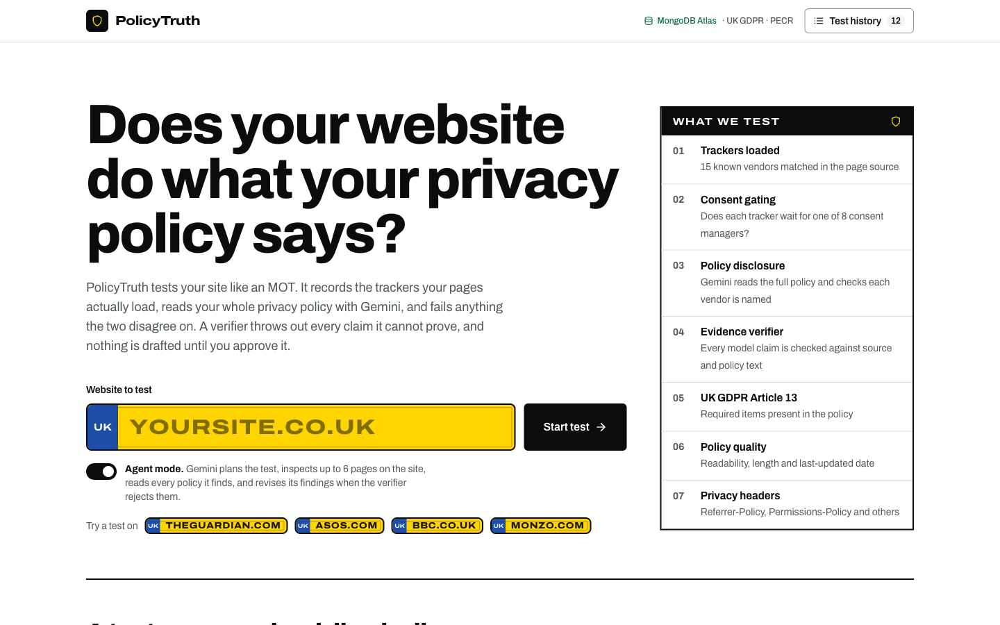
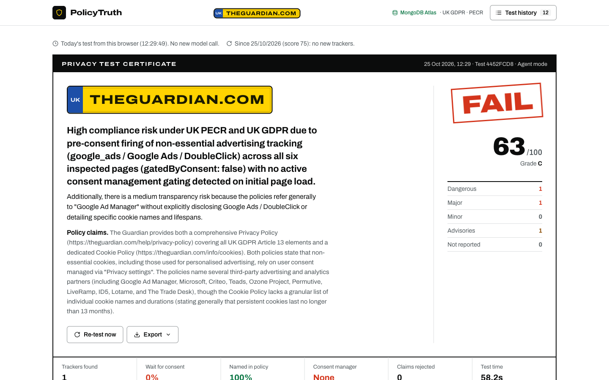
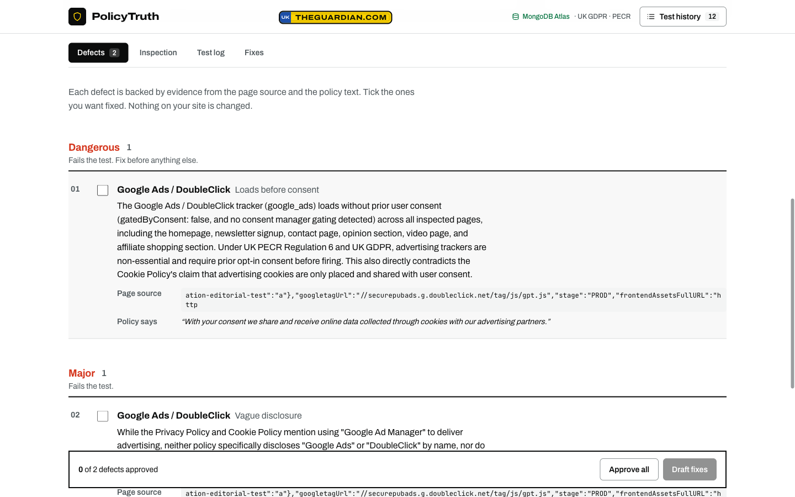
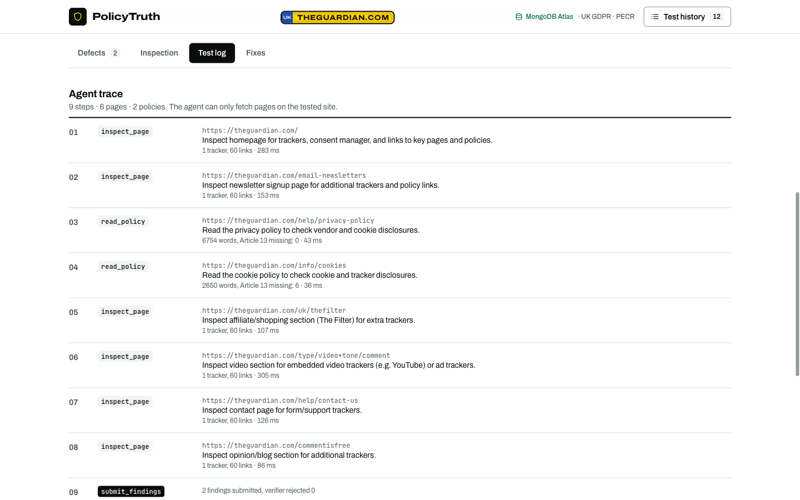

<div align="center">



# PolicyTruth

**Does your website do what your privacy policy says?**

An MOT for your privacy policy. A Gemini agent inspects the site, reads every policy it can find, and fails anything the two disagree on.<br/>
A verifier throws out every claim it cannot prove. Nothing is drafted until a human approves it.

[](https://policytruth-seven.vercel.app)


Built at **Encode London 2026** for the Google DeepMind, MongoDB and Agents That Ship challenges.

</div>

---

## Why it exists

Under UK GDPR and PECR, non-essential trackers need consent before they load, and the privacy policy must name who receives the data. The ICO actively reviews cookie compliance on major UK sites.

In practice, marketing teams add pixels through tag managers every week, and the privacy policy is a template nobody re-reads. Existing tools solve half the problem: cookie scanners list cookies but never read the policy, and policy generators write text but never look at the site.

PolicyTruth is for the UK startup founder or DPO who needs to know, today, whether the site and the policy match.

## How a test works

| | Step | What happens |
|---|---|---|
| 1 | **Scan** | A deterministic scanner reads the page source and lists every tracker and consent manager it finds. |
| 2 | **Read** | A Gemini agent plans the test, inspects up to 6 pages on the site and reads every privacy and cookie policy it finds. |
| 3 | **Verify** | A verifier checks each claim against the page source and the exact policy text. Rejected claims go back to the agent once, then are shown as "Not reported". |
| 4 | **Approve** | You tick the defects you agree with. Only then does Gemini draft code and policy fixes. |

## A tour

### The certificate

Every test ends in a certificate: the domain as a number plate, a **FAIL**, **PASS** or **REFUSED** verdict, a 0 to 100 score with grade, and a tally of defects by category.



Verdict rules, borrowed from the MOT:

| Verdict | When |
|---|---|
| **FAIL** | At least one verified Dangerous (high) or Major (medium) defect. |
| **PASS with minor defects** | Only Minor (low) defects. |
| **PASS** | No verified defects. |
| **REFUSED** | The site could not be fetched, so nothing was tested and no score is shown. |

### Defects, with the evidence

Each defect shows the line of page source and the exact policy quote it rests on. Claims the verifier rejected are listed separately, struck through, with the reason. Advisories cover missing Article 13 items, missing headers and stale policies.



### The agent at work

The **Test log** shows every tool call the agent made, in order, with its stated reason, result and timing, followed by the pipeline timings and the raw run log.



### Inspection, fixes and history

**Inspection** lists every tracker with its consent gate and policy disclosure, the UK GDPR Article 13 checklist, policy quality and privacy headers. After you approve defects, **Fixes** holds a consent-gated script for each one and the exact paragraph to add to the privacy policy, with copy buttons and Markdown, JSON or PDF export. **Test history** sits in the header; tests from today open instantly with no new model call.

## Quick start

Requirements: Node.js 20+, a Gemini API key, and optionally a MongoDB Atlas cluster.

```bash
git clone https://github.com/gnani4444/policytruth.git
cd policytruth
npm install
cp .env.example .env.local   # then fill in the values below
npm run dev                  # open http://localhost:3000
```

Enter a domain such as `theguardian.com` and press **Start test**. The first audit takes about 25 seconds.

## Configuration

Set these in `.env.local`, or as environment variables on Vercel.

| Variable | Required | Description |
|---|---|---|
| `GEMINI_API_KEY` | Yes | Gemini API key from Google AI Studio. |
| `GEMINI_MODEL` | No | Model id. Default `gemini-4-argon`. |
| `MONGODB_URI` | No | Atlas connection string. Without it, or when Atlas is unreachable, audits go to JSON storage (see below). |
| `PT_DATA_FILE` | No | Path of the JSON storage file. Default `.data/audits.json` locally, `/tmp/policytruth-audits.json` on Vercel. |

If the database password contains `@`, `:`, `/`, `?`, `#` or `%`, URL-encode it (for example `@` becomes `%40`).

For Vercel, allow access from anywhere (`0.0.0.0/0`) in Atlas Network Access, because Vercel functions have no fixed outbound IP.

### When MongoDB is offline

The app keeps working without Atlas. `lib/db.js` gives the API one storage interface:

- **Atlas** when `MONGODB_URI` is set and reachable.
- **JSON storage** otherwise: audits, approvals and fixes are written to a JSON file and cached in memory. A read-only snapshot of recent audits (`data/audits.seed.json`) is bundled with the app, so history works on a cold start.
- If an Atlas call fails mid-request, that call falls back to JSON and Atlas is skipped for 60 seconds instead of timing out on every request.
- The browser also caches today's tests in `localStorage`.

On Vercel the JSON file lives in `/tmp`, which belongs to one function instance and is cleared when the instance is recycled. It keeps the demo running during an outage; it is not durable storage. Audits written to JSON are not copied back to Atlas.

## Features

**Audit pipeline**
- Fetches the page and finds its privacy policy link.
- Detects 15 tracker vendors (Meta Pixel, Google Analytics, Google Tag Manager, Google Ads, TikTok, LinkedIn, X, Hotjar, Microsoft Clarity, Segment, Mixpanel, HubSpot, Intercom, Pinterest, Snap).
- Detects 8 consent managers (OneTrust, Cookiebot, Didomi, Usercentrics, Osano, CookieYes, Termly, Google Consent Mode).
- Records for each tracker whether its script is consent-gated, and whether the policy names the vendor.

**Agent mode (default)**
- Gemini runs as a tool-using agent with three tools: `inspect_page`, `read_policy` and `submit_findings`.
- It plans the audit itself: homepage first, then the pages most likely to carry extra trackers (signup, pricing, checkout, contact), then every privacy and cookie policy it finds. It can call several tools in parallel.
- Budget: up to 6 page inspections and 10 steps. Tools refuse any URL outside the audited site, so page content cannot steer the agent elsewhere.
- Feedback loop: when the verifier rejects findings, the rejection reasons go back to the agent. It can gather more evidence or drop the claim, then resubmit (one revision round).
- The **Test log** tab shows every tool call in order, with the agent's stated reason, result and timing.
- Example: on theguardian.com the agent found the full privacy policy at `/help/privacy-policy` (6,754 words) and the cookie policy, which a single-page fetch missed.

**Gemini reasoning, then verification**
- Gemini reads the full policy (up to 400,000 characters) and the scan. It proposes findings of three types: `undisclosed`, `pre_consent` and `vague_disclosure`, each with an exact policy quote.
- The verifier rejects a finding when the tracker is not in the page source, when the evidence contradicts it, when the quoted text is not in the policy, or when the policy could not be fetched. Rejected claims are shown with the reason.

**Human in control**
- The reviewer ticks the findings to act on. Gemini drafts fixes only for those: consent-gated script snippets and a privacy policy addition.
- Nothing is changed on the audited website.

**Readings on the certificate**
- Compliance score from 0 to 100, with a grade from A to F.
- Trackers detected, % consent-gated, % named in the policy.
- Verified findings by severity, and the share of model claims that survived the verifier.
- UK GDPR Article 13 coverage: 9 required items, such as lawful basis, retention, rights, withdrawing consent, the ICO complaint right and international transfers.
- Policy readability (Flesch reading ease), length and last-updated date with age in days.
- Privacy-related headers: `Referrer-Policy`, `Permissions-Policy`, `Strict-Transport-Security`.
- Per-step timings: fetch, policy, scan, Gemini, verifier.
- Tracker changes since the previous audit of the same site (needs MongoDB).

**Workflow**
- Views: Defects, Inspection, Test log and Fixes, with a sticky approve bar. Test history lives in a header drawer and on the home page.
- Same-day cache: a test of the same site from today loads from the browser or MongoDB, with no new model call. **Re-test now** forces a fresh test.
- Exports (menu on the certificate): Markdown report, raw JSON, print to PDF. Copy buttons on every fix.

## Architecture

Full architecture, data model and safety notes: [ARCHITECTURE.md](ARCHITECTURE.md). Interactive diagram: [docs/architecture.html](docs/architecture.html).


```text
URL ──> fetch page + headers ──> find policy link ──> fetch policy
                │
                ▼
     deterministic scan (lib/scan.js)        policy checks (lib/policy.js)
     trackers, consent gating, disclosure    Article 13, readability, age
                │
                ▼
     Gemini analysis (gemini-4-argon, thinkingLevel "high", JSON output)
                │
                ▼
     verifier: keep only claims backed by evidence
                │
                ▼
     human approves findings ──> Gemini drafts fixes
                │
                ▼
     MongoDB Atlas: policytruth.audits (scan, findings, verdicts, approvals, fixes)
```

| Path | Purpose |
|---|---|
| `app/page.js` | Certificate UI (client component). Motion components in `components/`. |
| `app/api/audit/route.js` | `POST` runs an audit or drafts fixes; `GET` returns recent audits. |
| `lib/scan.js` | Tracker and consent-manager detection, policy link finder, verifier. |
| `lib/policy.js` | Article 13 checklist, readability, last-updated date, privacy headers. |
| `lib/agent.js` | Agent mode: Gemini function-calling loop, same-site tools, verifier feedback round. |
| `lib/db.js` | Storage: MongoDB Atlas, with JSON-file fallback and a bundled seed when Atlas is unreachable. |

## API

`POST /api/audit`

```json
{ "url": "theguardian.com", "force": false, "mode": "agent" }
```

`mode` is `"agent"` (multi-page, tool-using agent, about 30 to 90 seconds) or `"quick"` (homepage plus linked policy, about 25 seconds). Agent results also include `trace`, `pagesInspected`, `policyUrls` and `revised`.

Returns the scan, findings (each with `verified` and `rejected_because`), `score`, `grade`, `policy`, `headers`, `changes`, `timings`, `log` and `auditId`. With `force: false`, an audit of the same host from today is returned with `cached: true`.

`POST /api/audit` (draft fixes)

```json
{ "action": "fix", "url": "https://theguardian.com/", "auditId": "<id>", "findings": [ ...approved findings ] }
```

Returns `code_fixes`, `policy_redline` and `summary`. The approval and fixes are saved on the audit document.

`GET /api/audit` returns the 15 most recent audits.

Errors return `{ "error": "<message>" }` with status 400 (bad input), 500 (missing key) or 502 (upstream fetch or model failure).

## Tests

```bash
npm test
```

Covers tracker detection, consent gating, disclosure matching, verifier rejections, Article 13 coverage and policy age.

## Design

The interface is a test certificate on white paper: ink, a yellow number plate for the domain, green for pass and red for fail. The rules are recorded in [DESIGN.md](DESIGN.md).

- Type: Archivo (variable width) for everything, JetBrains Mono only for evidence.
- Motion: [React Bits](https://reactbits.dev) (`BlurText`, `CountUp`, `DecryptedText`) and [motion-primitives](https://motion-primitives.com) via [21st.dev](https://21st.dev) (`AnimatedBackground`, `TextShimmer`), built on [Motion](https://motion.dev). All motion respects `prefers-reduced-motion`.
- Styling: Tailwind CSS v4.

## Deploy

```bash
vercel env add GEMINI_API_KEY production
vercel env add MONGODB_URI production
vercel deploy --prod
```

## Limits

- The scanner reads static HTML. Trackers that a tag manager injects at runtime are not seen.
- Policies rendered by JavaScript may return little text, which lowers coverage and readability accuracy.
- The Article 13 checklist uses keyword matching. A missing item is a prompt for review, not proof of a breach.
- Drafted fixes are suggestions for human review. PolicyTruth is not legal advice.

## Roadmap

- Headless browser capture of network traffic before and after consent.
- Atlas Vector Search over past findings and ICO guidance.
- Scheduled re-audits with alerts when the site or policy changes.
- Open a GitHub pull request with the approved fix.
